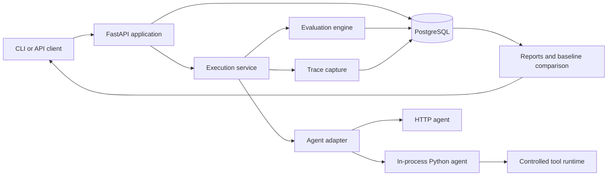

# High-level System Design

## 1. MVP architecture

AgentEval Lab is a local-first backend service for repeatable evaluation of AI agents. The MVP exposes its workflow through a FastAPI API and a minimal CLI. It persists state in PostgreSQL and runs experiments asynchronously through an in-process background execution service with bounded concurrency. There is no web dashboard, dedicated worker process, distributed queue, or multi-tenant control plane in this phase.

## 2. Core boundaries

- **Dataset service:** validates imports and publishes immutable dataset versions.
- **Agent adapter:** converts an HTTP or Python invocation into one normalized execution result. Adapters document unavailable telemetry instead of inventing it.
- **Tool runtime:** provides deterministic mock tools for controlled Python-adapter runs. MCP and approved staging tools are future integration modes.
- **Execution service:** creates runs, enforces timeout and concurrency policies, applies run-state transitions, and persists failure details. It is an interface with one in-process implementation in the MVP.
- **Evaluation engine:** invokes deterministic evaluators first and an explicitly configured optional LLM judge only when needed.
- **Reporting service:** returns machine-readable experiment reports, baseline comparisons, and CI gate decisions.

## 3. Execution contract

An experiment pins a dataset version, agent configuration snapshot, tool-runtime configuration, evaluator configuration, and applicable limits. It creates one test-case run per selected dataset item. A normalized result contains final output, ordered tool-call records, trace spans, usage, latency, and a structured execution error when applicable.

MVP experiment states are `queued`, `running`, `completed`, and `failed`. Case states are `pending`, `running`, `passed`, `failed`, `error`, and `skipped`. A case is `failed` when required evaluations do not pass; it is `error` when the platform cannot complete a valid execution or evaluation. A completed experiment may therefore contain failed or errored cases. Cancellation is introduced with durable execution in Phase 2.

The MVP runner starts work after the experiment is persisted and returns `202 Accepted`. It has no durable cross-process recovery guarantee. It must use explicit concurrency limits, record attempts and errors, and finalize an experiment idempotently. Do not introduce Redis or a worker fleet until the trigger in the roadmap is met.

## 4. Persistence and future tenancy

PostgreSQL stores datasets and versions, dataset items, agent configurations and snapshots, experiments, case runs, trace spans, evaluator results, metrics, and baseline comparisons. Stable UUIDs and explicit version fields are required. Records should reserve nullable owner/project references or equivalent service boundaries so organizations and authorization can be introduced later, but the MVP does not expose organization, membership, authentication, or billing features.

Store structured metadata needed to explain a run: adapter type/version, model and prompt identifiers when supplied, evaluator versions, tool configuration, limits, timestamps, raw provider usage, and normalized metrics. Record unavailable or external nondeterministic inputs explicitly rather than claiming full reproducibility.

## 5. Safety and deployment

The API process does not execute arbitrary uploaded code. The Python adapter runs trusted, locally registered callables only. Mock tools are the default; production side effects are disabled. HTTP integrations require explicit endpoint and credential configuration, and traces are redacted before persistence. Local development starts with FastAPI and PostgreSQL; the CLI calls the same application services and never reimplements evaluation logic.

## 6. Deferred Features & Future Roadmap

| Feature group | Status | Why deferred | Trigger |
|---|---|---|---|
| Dedicated workers, durable queues, distributed execution, and advanced scheduling | Deferred, Phase 2 | The MVP needs a reliable runner before operating distributed infrastructure. | Runs exceed in-process reliability or throughput limits, or restart recovery is required. |
| Caching, advanced reproducibility, advanced evaluators, judge calibration, regression statistics, trace analysis, and cost analytics | Deferred, Phase 2 | These require trusted core results and enough run data to validate their value. | Core runner is stable and repeated evaluation needs are measured. |
| CI integrations, SDKs, config files, schedules, webhooks, and notifications | Deferred, Phase 3 | The CLI/API contract must stabilize first. | Developers repeatedly integrate the manual CLI workflow into delivery pipelines. |
| Authentication, tenants, hosted isolation, secrets, quotas, retention, and operations | Deferred, Phase 4 | The MVP is single-user and local-first. | Multiple users or hosted deployment has a validated requirement. |
| Dashboard, advanced datasets, synthetic/red-team evaluation, human review, specialized suites, sharing, governance, and external observability integrations | Deferred, Phase 5 | These do not prove the core evaluation loop. | A proven workflow has documented demand for each capability. |

The [roadmap](ROADMAP.md#deferred-features--future-roadmap) is the authoritative per-feature register: it records purpose, dependencies, trigger, and acceptance criteria. A deferred capability may be pulled forward only by updating that register with the evidence and scope decision.
