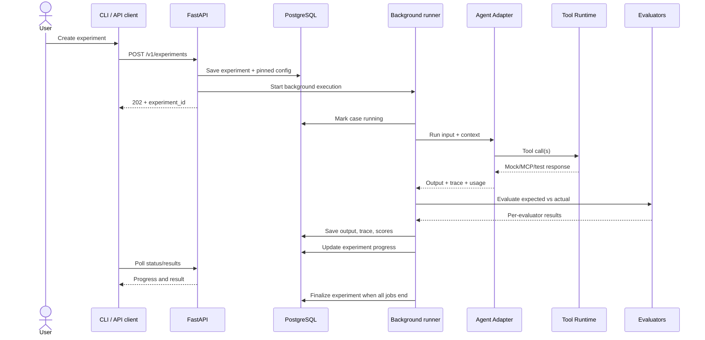

# End-to-end Testing Flow

## 1. User workflow

1. Create/import a dataset through the API or CLI.
2. Register an HTTP or in-process Python agent configuration.
4. Choose a tool runtime: native mocks, MCP mock, or approved staging tools.
5. Configure concurrency, timeout, maximum agent steps/tool calls and budget.
6. Create an experiment using a pinned dataset version.
7. The execution service creates and runs test-case work under its concurrency limit.
8. The background runner executes each case through the selected agent adapter.
9. Capture final output, tool calls, trace spans, errors, latency and usage.
10. Run deterministic evaluators.
11. Run optional LLM judge only for cases/evaluators that need it.
12. Persist each evaluator result and aggregate metrics.
13. Compare against a selected baseline.
14. Return a report through the API or CLI and optionally return a CI pass/fail status.

## 2. Sequence diagram

## 3. Detailed case lifecycle

- `pending`: job exists but has not started.
- `running`: worker owns the case and executes it.
- `passed`: required assertions pass.
- `failed`: execution completed but one or more required assertions failed.
- `error`: infrastructure, adapter, provider or evaluator error prevented valid completion.
- `skipped`: case was intentionally not run.

Experiment lifecycle:
- `queued` → `running` → `completed`
- `running` → `failed` for unrecoverable experiment-level failures

Cancellation is deferred until the execution backend has durable worker/queue support. The MVP records failures and completes remaining work according to its configured failure policy.

An experiment can have failed test cases and still have experiment status `completed`; execution completion and evaluation success are different concepts.

## 4. Example: order status test

Input: “Kiểm tra giúp tôi đơn hàng ORD-1001 đang ở trạng thái nào?”

Expected behavior:
1. Agent calls `get_order` with `order_id=ORD-1001`.
2. Mock tool returns a deterministic order fixture with status `shipping`.
3. Agent answers that the order is being shipped.
4. Evaluators verify tool selection, arguments, status correctness and prohibited actions.
5. Result records each assertion, trace, latency and usage.

The sample order IDs and responses are illustrative; create matching fixtures in a test runtime.

## 5. Comparison flow

- Run Agent A and Agent B on the same immutable dataset version.
- Pin relevant configuration: model, prompt/version, adapter version, tool configuration and evaluator versions.
- Compare per-case results and aggregate metrics.
- Show regressions and improvements by case.
- Do not conclude that one agent is universally better based on one dataset. The conclusion applies to the evaluated dataset and setup.

## 6. CI flow

1. CI builds or selects the candidate agent version.
2. CLI imports or selects a specified dataset/version and calls the same application services as the API.
3. Platform evaluates cases and calculates metrics.
4. Regression gate compares candidate with baseline and applies hard constraints.
5. CLI exits `0` if gate passes, non-zero otherwise.
6. CI publishes summary and links/artifacts when available.

Use fixed test data, deterministic mock tools and bounded model calls for predictable CI costs. Use real model calls selectively when evaluating model behavior itself.

## 7. Deferred execution capabilities

The in-process background runner is an MVP choice, not an execution guarantee across process restarts. Dedicated workers, a durable queue, distributed execution, advanced scheduling, and recovery are deferred. The run-state and execution-service contracts are deliberately stable so those capabilities can replace the runner without changing datasets, adapters, evaluators, or result semantics. See the [roadmap](ROADMAP.md#phase-2--reliability-scalability-and-evaluation-quality) for implementation triggers.
